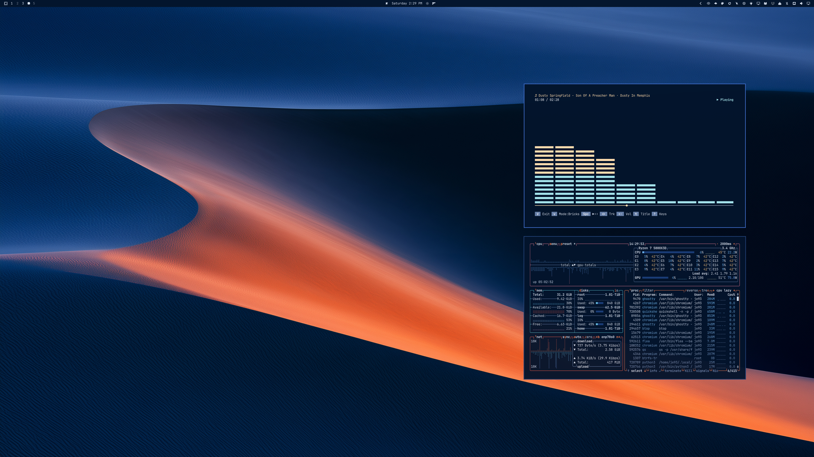
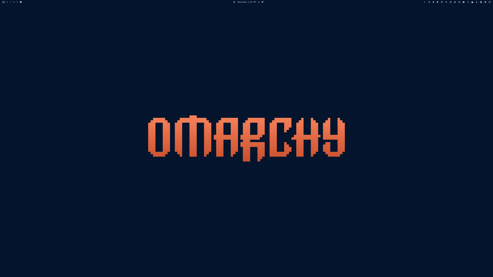

# Cobalt Dunes

Sand dunes at blue hour: deep cobalt shadows and one coral-lit crest. A dark theme for Omarchy.





## Install

For **Omarchy 4 with Omarchy Shell**:

```sh
omarchy theme install https://github.com/erikrjohansson/omarchy-cobalt-dunes-theme
```

Use `omarchy theme bg next` to switch between the dune and wordmark wallpapers.

## Update

```sh
omarchy theme update
```

## Remove

```sh
omarchy theme remove cobalt-dunes
```

## The theme

- Windows, menus and notifications in the dunes' deep cobalt shadow, with the crest's coral as the accent.
- Vivid terminal colors taken from the wallpaper: cobalt ridgelines, coral and warm sand.
- A top bar that follows your Omarchy bar setting.
- GTK 3 / GTK 4 styling and orange Yaru folder icons.
- Application configs derive from `colors.toml` through Omarchy templates.

## Wallpapers

Two **6016 × 3384** wallpapers are included.

[Dune crest](backgrounds/01-cobalt-dunes-crest.jpg) · [Wordmark](backgrounds/02-cobalt-dunes-wordmark.jpg)

## License

[MIT](LICENSE) · [Omarchy artwork attribution](THIRD_PARTY_NOTICES.md)
